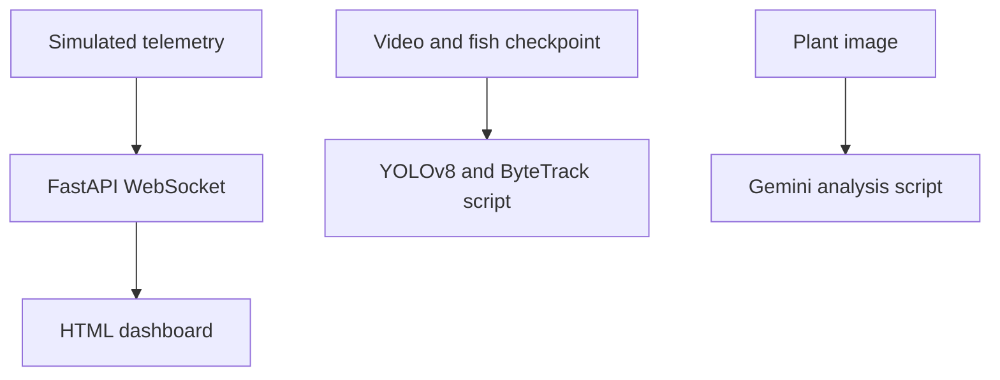

# AquaSustain
### AIoT Ecosystem Manager
**Python · FastAPI · WebSockets · ESP32-S3 · YOLOv8 · ByteTrack · Gemini API**

An academic project exploring how water sensing, fish tracking and plant-image analysis can support aquaponics and aquaculture monitoring.

## Project context
Completed in **July 2026** as a four-member FYP-II project at **UMT Lahore**, supervised by **Mahmood Hussain**.

**Team:** Muhammad Ali Baqar · Madiha Hamid · Muhammad Tayyab Ali · Muhammad Adil Hussain

This public repository is an **educational reconstruction prepared with AI assistance**, not the original submitted code. Original trained fish weights, calibration records, thesis source and experiment logs are not included.

## What you can run

| Component | Entry point | Current scope |
| --- | --- | --- |
| Live dashboard | `app.py`, `index.html` | FastAPI/WebSocket demo streaming **simulated** raw turbidity readings |
| Sensor example | `firmware/turbidity.ino` | ESP32-S3 serial ADC example; calibration and ingestion bridge are not implemented |
| Fish tracking | `fish_tracking.py` | YOLOv8/ByteTrack inference entry point; requires your fish-specific weights and video |
| Plant images | `plant_health.py` | Gemini image-analysis client; requires a local API key and configured model |

## Demonstration architecture



The sensor, fish and plant scripts are separate entry points in this reconstruction. They are not yet integrated into one deployed controller.

## Quick start

```bash
python -m venv .venv
# Activate the environment for your operating system.
pip install -r requirements.txt
uvicorn app:app --host 127.0.0.1 --port 8000
```

Open **http://127.0.0.1:8000**. The page labels its readings as simulated. Raw ADC values are not calibrated NTU.

See [RUN.md](RUN.md) for fish tracking, plant-image analysis and hardware setup notes.

## Validation and limits
- Python source syntax was checked during preparation.
- Hardware, GPU inference, API calls and trained-model performance were not validated here.
- No performance metrics are claimed for this reconstruction.
- Plant-image output describes possible causes and uncertainty; it does not establish a confirmed diagnosis.
- No automatic actuation is implemented.
- Keep API keys outside the repository. Review Ultralytics licensing before distribution or deployment.

## Next engineering steps
Connect authenticated sensor ingestion, establish calibration against reference readings, supply a licensed fish dataset and checkpoint, and record reproducible evaluation results before making performance claims.

## Rights
No rights are asserted over third-party datasets, model weights or missing team artifacts. Obtain team permission before adding original thesis materials.
